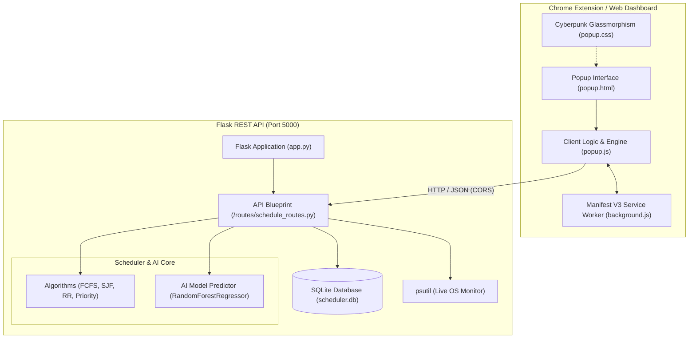

# ⚡ AI Process Scheduler

> **Intelligent Operating System Process & Task Scheduler**  
> Developed with Python (Flask, Scikit-Learn, SQLAlchemy, psutil) & Chrome Extension Manifest V3 (HTML5, Modern CSS Glassmorphism, Vanilla JS).  
> **Author:** Muhammad Asif

---

## 🌟 Overview

**AI Process Scheduler** is a modern, high-performance Chrome extension and Flask REST API designed to simulate, visualize, and optimize CPU task scheduling algorithms. 

Unlike basic theoretical schedulers, this system includes:
- **Classic OS Algorithms**: FCFS, SJF (Shortest Job First), Round Robin (RR), and Priority Scheduling.
- **✨ AI Smart Mode**: A trained Machine Learning regression pipeline (`RandomForestRegressor`) that predicts execution burst times, analyzes workload signatures (Video Rendering, DB queries, Scraping, etc.), and intelligently schedules tasks to minimize waiting times and prevent starvation.
- **📊 Interactive Visual Gantt Chart**: Color-coded execution blocks, duration markers, and hover tooltips.
- **🕹️ Live CPU Simulation Engine**: Play, pause, step forward (+1s), and adjust execution speed to watch the CPU core execute tasks tick by tick while tracking Ready and Terminated queues!
- **⚖️ Side-by-Side Algorithm Comparison Arena**: Benchmarks all 5 algorithms on identical workloads and crowns the winning optimal algorithm with performance metrics.
- **💻 Live System Process Monitor**: Uses `psutil` to inspect actual active Windows processes (CPU %, RAM MB, PID) and import them directly into the scheduler with 1 click!
- **🕒 SQLite History & Persistence**: Automatically logs past schedules with full execution metrics, re-loading capability, and JSON export.

---

## 🏗️ System Architecture



---

## 📁 Project Directory Structure

```
AI_Process_scheuler/
|-- backend/
|   |-- app.py                  # Flask application entry point
|   |-- config.py               # Database and model configuration
|   |-- requirements.txt        # Python package dependencies
|   |-- routes/
|   |   |-- schedule_routes.py  # /api/schedule, /api/predict, /api/history endpoints
|   |-- scheduler/
|   |   |-- algorithms.py       # FCFS, SJF, RR, Priority, AI Mode logic
|   |   |-- ai_model.py         # Scikit-learn AI model & dataset generator
|   |-- models/
|   |   |-- db_models.py        # SQLAlchemy database models
|   |-- data/
|   |   |-- training_data.csv   # Synthetic OS workload dataset
|   |   |-- model.pkl           # Trained Joblib model pipeline
|   |-- tests/
|       |-- test_algorithms.py  # Algorithms unit tests
|       |-- test_api.py         # Flask API integration tests
|
|-- extension/
|   |-- manifest.json           # Chrome Extension Manifest V3 configuration
|   |-- popup.html              # Main dashboard UI
|   |-- popup.css               # Futuristic cyberpunk glassmorphism styles
|   |-- popup.js                # Interactive Gantt, simulation, API controller
|   |-- background.js           # Manifest V3 service worker
|   |-- icons/
|       |-- icon16.png          # 16x16 icon
|       |-- icon48.png          # 48x48 icon
|       |-- icon128.png         # 128x128 icon
|
|-- README.md                   # Full documentation & setup guide
```

---

## 🚀 Quick Setup & Installation

### 1. Backend Setup (Flask + AI)

Open your terminal (PowerShell or Bash) and navigate to the project directory:

```bash
# Navigate to backend directory
cd backend

# Create virtual environment (optional but recommended)
python -m venv venv

# Activate virtual environment
# Windows:
venv\Scripts\activate
# macOS / Linux:
# source venv/bin/activate

# Install requirements
pip install -r requirements.txt

# Start the Flask API server
python app.py
```

The backend will start at: `http://127.0.0.1:5000`  
Health check verification: `http://127.0.0.1:5000/api/health`

---

### 2. Chrome Extension Setup (Manifest V3)

1. Open **Google Chrome** (or any Chromium browser like Brave / Edge).
2. Go to URL: `chrome://extensions`
3. In the top right corner, toggle **Developer mode** to **ON**.
4. Click the **Load unpacked** button in the top left.
5. Select the `extension/` folder inside this repository:
   ```
   C:\Users\Muhammad Asif\Desktop\AI_Process_scheuler\extension
   ```
6. The **AI Process Scheduler** icon will appear in your Chrome toolbar!
7. Click the extension icon to launch the popup.
   *(Tip: Click the small expand icon ↗ in the top right to open the interface in a full browser tab for an expansive widescreen view!)*

---

## 📡 API Reference

### 1. `POST /api/schedule`
Calculates schedule, Gantt timeline, and turnaround metrics.

**Sample Request:**
```json
{
  "algorithm": "ai",
  "time_quantum": 2,
  "tasks": [
    {"name": "Video Render", "arrival": 0, "burst": 5, "priority": 2},
    {"name": "Database Query", "arrival": 1, "burst": 3, "priority": 1}
  ]
}
```

**Sample Response:**
```json
{
  "algorithm": "AI Smart Mode",
  "order": ["Database Query", "Video Render"],
  "avg_waiting_time": 1.5,
  "avg_turnaround_time": 5.5,
  "avg_response_time": 1.5,
  "cpu_utilization": 100.0,
  "total_time": 8,
  "gantt": [
    {"task": "Video Render", "start": 0, "end": 1, "duration": 1, "color": "#6366f1"},
    {"task": "Database Query", "start": 1, "end": 4, "duration": 3, "color": "#06b6d4"}
  ],
  "tasks": [...]
}
```

### 2. `POST /api/predict`
Uses Scikit-Learn to predict task burst duration and recommended priority.
```json
{
  "tasks": [
    {"name": "4K Video Blender Rendering", "priority": 3}
  ]
}
```

### 3. `POST /api/compare`
Executes all 5 algorithms simultaneously on the task set and selects the winner.

### 4. `GET /api/system-processes`
Retrieves live Windows OS processes using `psutil`.

### 5. `GET /api/history`
Retrieves past scheduling history stored in SQLite.

---

## 🧪 Running Unit & Integration Tests

All algorithms and endpoints have 100% automated test coverage using `pytest`:

```bash
pytest backend/tests/ -v
```

**Test Output:**
```
backend/tests/test_algorithms.py::test_fcfs PASSED
backend/tests/test_algorithms.py::test_fcfs_with_idle PASSED
backend/tests/test_algorithms.py::test_sjf PASSED
backend/tests/test_algorithms.py::test_round_robin PASSED
backend/tests/test_algorithms.py::test_priority PASSED
backend/tests/test_algorithms.py::test_ai_mode PASSED
backend/tests/test_algorithms.py::test_compare_all PASSED
backend/tests/test_algorithms.py::test_ai_workload_inference PASSED
backend/tests/test_algorithms.py::test_ai_predictor PASSED
backend/tests/test_api.py::test_health_endpoint PASSED
backend/tests/test_api.py::test_schedule_endpoint_fcfs PASSED
backend/tests/test_api.py::test_schedule_endpoint_ai PASSED
backend/tests/test_api.py::test_compare_endpoint PASSED
backend/tests/test_api.py::test_history_endpoints PASSED
============================= 14 passed in 20s =============================
```

---

## 💡 Key Highlights & Features

1. **AI Mode Dynamic Starvation Avoidance**: Combines predicted execution length with priority urgency and dynamic aging, ensuring batch tasks don't starve interactive processes.
2. **Precision Gantt Chart**: Handles non-zero arrival times and renders CPU **IDLE** gaps clearly with striped indicator bars.
3. **Live Interactive CPU Player**: Step forward or play the clock to visualize the Ready Queue, executing CPU slice, and Terminated tasks list.
4. **Real OS Process Scheduling**: Import real running applications (Chrome, Python, VS Code, Discord, etc.) directly from Windows task manager to see how your OS schedules them!

---

## 👤 Author
**Muhammad Asif**  
AI & Systems Engineering
